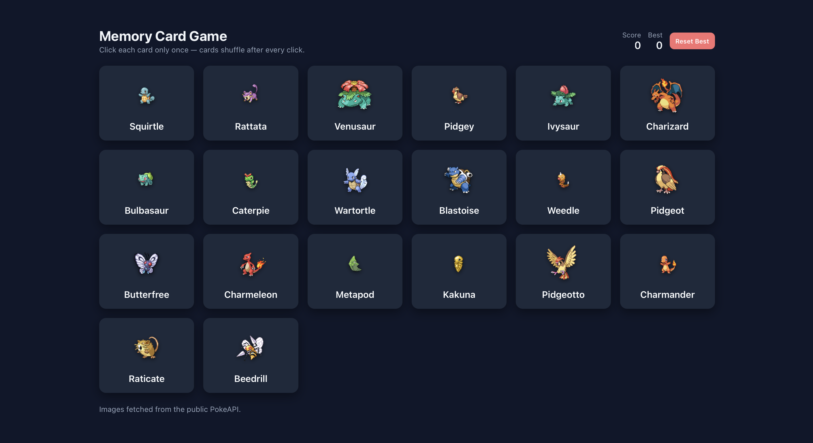
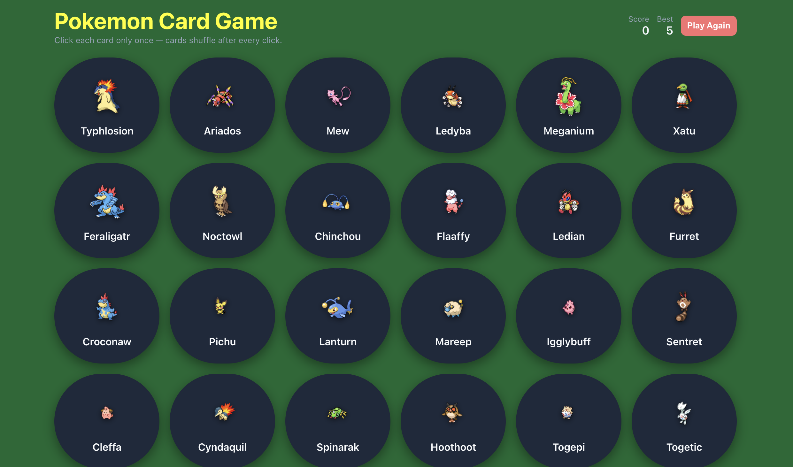

22100310 박진수
# Assignment 10

## Deployment
| 항목 | URL |
| --- | --- |
| GitHub |  |
| Vercel |  |

## Project Information
**프로젝트 소개**: React를 이용한 포켓몬 카드 기억하기 게임입니다. 한 종류의 포켓몬 카드는 한 번만 선택할 수 있고, 고를 때마다 점수가 올라가며 카드가 섞입니다. 이미 선택했던 카드를 고르면 패배합니다.
선택 이유, 원본 GitHub URL 및 라이선스

**선택 이유**: React와 JavaScript로 동작하는 간단한 프로젝트를 claude를 통해 추천받았습니다. 그 중 README.md와 package.json을 포함하고 Backend/Database 없이 실행 가능한 프로젝트인지 확인한 후 재밌고 커스터마이징 하기 용이할 것 같은 프로젝트를 골랐습니다. 수정 및 재배포 허용 여부를 확인하고 원본 README를 `README_ORIGINAL.md`에 두어 확인할 수 있도록 했습니다.

**주요 기능**
1. 포켓몬 카드 클릭 시 점수 +1 증가 및 포켓몬 카드 셔플
2. 클릭된 카드를 기억하여 이미 클릭된 카드를 다시 눌렀다면 패배 처리
3. 최고 기록 및 플레이 내역 리셋하기 버튼
   
**Original Project**
| 항목 | 내용 |
| --- | --- |
| 원본 GitHub URL | https://github.com/hencci/memory-card |
| License | README_ORIGINAL.md에서 확인 가능 |

## Installation
```bash
git clone https://github.com/hencci/memory-card
cd memory-card
npm install
npm run dev
```
프로젝트를 clone하고 실행하는 절차를 README.md에서 확인하여 실행합니다. package.json의 scripts 부분에서 실행에 대한 정보를 확인하고 해당 방법으로 실행합니다.

**실행 화면**



## Source Code Exploration
**Project Structure**
src 폴더 안에 있는 App.jsx 파일에 게임의 state 및 모든 핵심 function의 작용을 담당하고, main.jsx 파일이 React와 CSS, 그리고 App안의 컴포넌트 들을 모아 실행시키는 역할을 합니다. package.json은 프로젝트 실행 방법 (React, Vite) 및 실행 스크립트를 담당합니다.

**React Component**
Card.jsx는 클릭시 props를 parent(App)에게 보내 클릭된 카드를 알려주는 역할을 하고, Header.jsx는 점수와 리셋에 대한 정보를 받아 표시하는 역할을 합니다.

**Code Analysis**
```bash
  function shuffleArray(array) {
    const a = [...array];
    for (let i = a.length - 1; i > 0; i--) {
      const j = Math.floor(Math.random() * (i + 1));
      [a[i], a[j]] = [a[j], a[i]];
    }
    return a;
  }
```
App.jsx에 있는 함수 중 shuffle 기능을 담당합니다. [...array]로 배열 복사본을 만들어 0~i의 위치 중 Math.random()으로 랜덤한 위치 j를 골라 i의 자리와 바꿉니다.


## Customizing
| 구분 | 수정 파일 | 수정 내용 |
| --- | --- | --- |
| Text | Header.jsx | 제목: Memory Card Game -> Pokemon Card Game <br/> 버튼: Reset Best -> Play Again
| Style | index.css | 배경색: navy -> dark green <br/> 카드 크기: 16px -> 25px <br/> 제목: 크기 24px -> 36px, 색 white -> yellow <br/> 카드 모양: border-radius 10px -> 80px|
| UI/Data | App.jsx | 포켓몬 카드 개수 및 종류: pokeapi 호출하는 link에서 개수를 30을로 늘리고 도감 150번대부터 나오도록 변경 |

**수정화면**


## Weekly Review - Week 10

### Key Learning
1.
2.
3.

### AI / Search Usage
| 도구 | 사용 목적 | 참고·반영한 기능 | 직접 수정한 내용 | 배운 점 | AI 기여율 |
| --- | --- | --- | --- | --- | --- |
|  |  |  |  |  |  |

### Problem & Solution
- **Problem**:
- **Solution**:

### Reflection
-